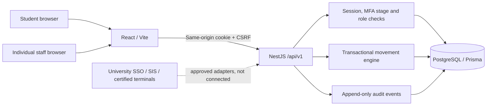
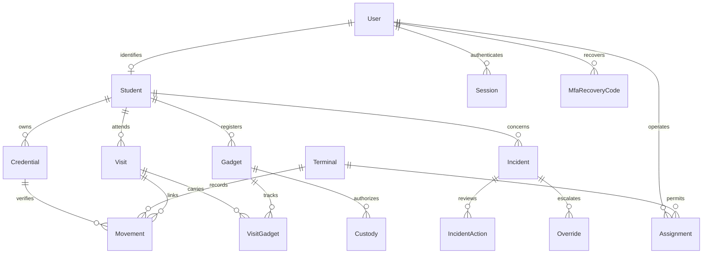
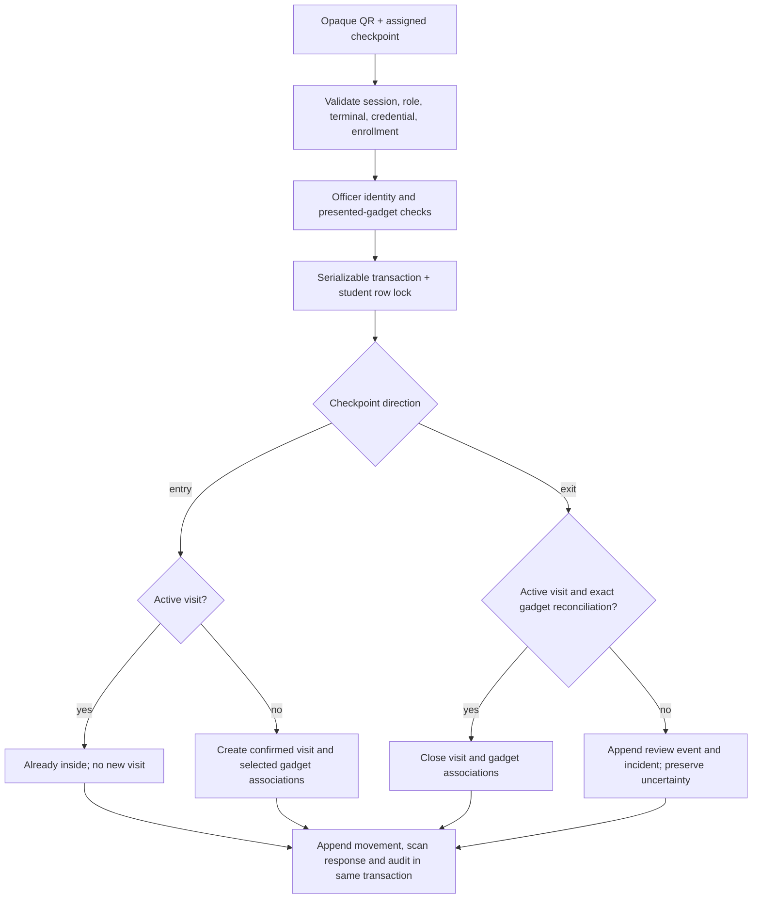

# SecureGate

University campus access, student movement and gadget accountability. **Version 0.2 — working local development release; not approved for physical gate deployment.** All supplied identities are synthetic. University SSO, institutional integrations and security certification are not claimed.

## Six main files

| Responsibility                   | Primary file                                                                                                     |
| -------------------------------- | ---------------------------------------------------------------------------------------------------------------- |
| Frontend                         | `apps/web/frontend.tsx` — React, role routes, TanStack Query, validated forms, QR issuance/scanning, dashboards  |
| Backend                          | `apps/api/backend.ts` — NestJS REST API, sessions, authorization, identity, gadgets, movements, incidents, audit |
| Database                         | `prisma/schema.prisma` — normalized PostgreSQL entities and Prisma client                                        |
| Infrastructure                   | `infrastructure.yml` — local PostgreSQL, persistent volume and readiness check                                   |
| Development environment          | `development.mjs` — portable setup, generated local secrets and service startup                                  |
| Repository/application structure | `README.md` — architecture, requirements, security boundaries, runbook and progress                              |

Supporting files are necessary for a runnable TypeScript application: package manifests/lockfile, framework configuration, frontend stylesheet/HTML, SQL migration, tests and GitHub Actions. This six-main-file layout deliberately consolidates the requested documentation here rather than creating seventeen separate documents. It is a compact modular monolith; split the backend services and frontend features into folders before the codebase grows significantly.

```text
SecureGate/
  apps/
    web/{frontend.tsx,styles.css,index.html,vite.config.ts,tsconfig.json,package.json}
    api/{backend.ts,tsconfig.json,package.json}
  prisma/
    schema.prisma
    migrations/{202611010001_initial,202611010002_staff_mfa,202611010003_mfa_enrollment_expiry}/migration.sql
  tests/{security.test.ts,integration.ts,run-integration.mjs,browser.spec.ts}
  .github/workflows/ci.yml
  infrastructure.yml
  development.mjs
  prisma.config.ts
  package.json / package-lock.json
  .env.example / .gitignore
  README.md
  .local/                 # ignored: individually generated synthetic account passwords
  .env                    # ignored: local database password and credential HMAC key
```

## Install and run

Requirements: **Node.js 24 LTS** (22.12+ is accepted), npm, Git, Docker with Compose v2, and a modern browser. Windows: use VS Code, PowerShell and Docker Desktop with Linux containers. No paid service or scanner hardware is required.

From the repository root, PowerShell:

```powershell
npm.cmd ci --ignore-scripts
npm.cmd run setup
node development.mjs accounts
npm.cmd run dev
```

Bash/macOS/Linux: use the same commands with `npm` instead of `npm.cmd`. Setup generates random local-only values only if `.env` is absent, starts PostgreSQL, generates Prisma, applies committed migrations and seeds synthetic accounts once. Each role gets an independent random password; there is no universal demo or admin password. `node development.mjs accounts` deliberately displays passwords only on your own local terminal. Never paste its output in issues or commit `.local/`.

### Local PostgreSQL without Docker

If PostgreSQL is installed locally, use `npm.cmd run setup -- --local-db` for the initial setup instead. On Windows, setup detects PostgreSQL 18, 17 or 16 under Program Files; for another location, set `$env:PG_BIN` to its `bin` directory first. This creates a password-protected, project-specific cluster in the ignored `.local/postgres/` directory, listening on `127.0.0.1:5433`, and records its configuration in `.env`.

After setup, `npm.cmd run dev` starts the local database when needed, the API on port 3000 and the frontend at **http://localhost:5173**. Retrieve the generated sign-in details with `node development.mjs accounts`. Stop the app with Ctrl+C and stop the database with `node development.mjs db:stop`; database records are retained. Repeating setup preserves the existing accounts and data.

### First staff sign-in and account security

Use the individual initial password from the ignored local account file. Every staff role must then enroll a TOTP authenticator before any operational API can be accessed. Scan the enrollment QR in an authenticator app, enter its six-digit code and save the twelve one-use recovery codes. The enrollment secret and recovery codes are shown only during this controlled process. Keep them in secure personal storage, not this repository. Students can enroll optionally under **Account security**.

Later sign-ins require the password plus a current authenticator code or one unused recovery code. A used TOTP time step cannot be replayed, even in a concurrent request; wait for the next code when necessary. Recovery codes work once and trigger an account notification. Replacing them requires the current password and a valid second factor and invalidates all prior recovery codes.

**Account security** also allows password changes with current-password verification and, where enrolled, a second factor. Other sessions are revoked and the current cookie is rotated. The original local account file is not rewritten with your new password; keep your current credentials in a password manager. There is deliberately no administrator MFA-bypass or unaudited reset endpoint. If both the authenticator and all recovery codes are lost, verified institutional recovery is still an outstanding workflow; do not reset database fields as an operational workaround.

Migration `202611010002_staff_mfa` invalidates legacy staff sessions so password-only sessions cannot survive the upgrade. Student and campus movement records are preserved.

Open port **5173** in your local browser. Vite proxies `/api` to Nest on port **3000**; there are no cross-origin cookies or browser-stored bearer tokens. API reference is at `/api/docs` on the API port in development. PostgreSQL binds only to the local loopback interface. The app requires a working database and never substitutes fake API responses.

```powershell
npm.cmd run typecheck
npm.cmd test
npm.cmd run test:integration
npm.cmd run build
npm.cmd run test:browser
```

The integration runner creates a random isolated PostgreSQL database, deploys migrations, tests real HTTP requests and removes only that database afterward. Its database user needs `CREATEDB`, which the local Compose user has. Never use a production database URL for development. Browser tests also create a fresh isolated database and per-run synthetic account files under an ignored temporary `.local/sg_test_*` directory. They run on API port 3002 and web port 5174, never attach to the development server, and delete only their own database and test account directory afterward. Traces and automatic failure screenshots are disabled to avoid persisting authenticator secrets in test artifacts. Install the Playwright browser once with `npx.cmd playwright install chromium` or set `PLAYWRIGHT_CHROMIUM_EXECUTABLE` to an installed Chromium executable.

`npm run setup` is repeatable and preserves the database, `.env` and account file. Stop processes with Ctrl+C; stop PostgreSQL with `docker compose -f infrastructure.yml stop`. `docker compose down` retains the named volume. Do not add `-v` unless intentionally destroying your local records.

### Manual acceptance walkthrough

1. Sign in as the **registrar**, select the synthetic student and verify identity in the simulator. Issue their ID; the QR and opaque value appear only in the authorized issuance response. Copy the value for the simulator, then clear the display. Issuance revokes the prior active credential.
2. Sign in as the **student**, submit a laptop with its physical serial number.
3. Sign in as the **verifier**, inspect the pending device and record approval with findings and physical-check confirmation.
4. Sign in as the **officer**, choose assigned **Gadget entry**, paste or scan the issued credential, inspect the identity, select only the laptop physically presented and confirm passage.
5. Repeat the request or scan while inside: no second active visit is opened. Select **Gadget exit**, reconcile the same gadget and confirm exit. Missing or unexpected gadgets produce a review case and preserve the uncertain visit. Software must never obstruct emergency egress.
6. Sign in as the **student** to see only their movement history and notifications; report the ID lost. Further use of that credential is rejected.
7. Inspect the supervisor’s incidents and independent review decisions, management’s persisted aggregates, and the auditor’s append-only record of privileged actions.

The seeded student has no verified photograph. The placeholder is explicitly labeled. It must never be treated as photo verification outside this synthetic simulator.

## Scope and progress

- [x] npm workspaces, React/TypeScript/Vite/Tailwind, NestJS, PostgreSQL, Prisma and committed migration.
- [x] Individual local accounts, scrypt password hashes, server-side expiring sessions, HttpOnly/SameSite cookies, CSRF and login throttling.
- [x] Eight fixed roles, backend authorization, own-record restrictions, checkpoint operator assignments.
- [x] Registrar enrollment; 256-bit opaque QR issuance, keyed digest storage, revocation and lost-ID reporting.
- [x] Gadget submission, independent physical approval/rejection, duplicate serial review, lost-gadget reporting and in-app decision notifications.
- [x] Entry/exit engine, assisted and unconfirmed registration-only modes, transactional visits, unique active-visit constraint and idempotency.
- [x] Camera/USB/manual browser scanner simulator; QR rendering for authorized issuance.
- [x] Incident state machine, attributable notes, independent supervisor review decisions. Approved review does **not** bypass movement controls.
- [x] Temporary custody API with an independent supervisor, time window and gadget approval checks; custody is validated on scans.
- [x] Persisted aggregate counts and hourly chart, qualified occupancy estimate, illustrative capacity utilization calculator.
- [x] Append-only audit/movement/incident-action SQL triggers, health check, backend build, browser build, automated tests and CI configuration.
- [x] Mandatory staff TOTP MFA, optional student MFA, encrypted enrollment, replay rejection, one-use recovery codes and password-change/session-revocation UX.
- [x] PostgreSQL-backed authentication quotas and isolated browser-test databases.
- [ ] University SSO, forgotten-password recovery and institution-approved recovery when all MFA factors are lost.
- [ ] Verified profile-photo/evidence upload pipeline, media access controls and metadata stripping.
- [ ] Approved CSV import, enrollment synchronization and actual university integration.
- [ ] Gadget ownership transfers, retirement workflow, favorite gadget sets and custody request/owner-consent UI.
- [ ] Authenticated WebSocket subscriptions, notification read states and reliable delivery queue (current updates use authorized HTTP polling).
- [ ] Cryptographically authenticated managed terminals, heartbeat agent and sensor/turnstile integration.
- [ ] Configurable granular permissions and dual-controlled privileged role administration (roles are currently fixed).
- [ ] Full scan latency percentiles, realistic stochastic queue simulation, load/outage recovery suite and measured pilot targets.
- [ ] Signed/manual fallback reconciliation, approved movement correction execution, controlled CSV exports, archival/deletion and retention jobs.
- [ ] Separate least-privilege runtime database user, external tamper-evident audit storage and tested recovery procedures.
- [ ] Independent security review, accessibility audit, lawful-processing assessment and university authorization.

These are explicit remaining requirements, not implied completed features. In particular this release is **not** the complete production system in the original brief. The next milestone is verified identity photographs and managed-terminal authentication before a controlled institutional pilot. `NODE_ENV=production` intentionally refuses to start until those requirements are implemented and reviewed.

## Requirements and product behavior

SecureGate records validated campus access and individually inspected gadget movements, reduces manual gate-book entry, and supports accountable investigation. It does not claim classroom attendance, tuition enforcement, continuous surveillance or physical turnstile enforcement. Unknown university rules remain configurable assumptions. The default institution is “Demo University”; set `INSTITUTION_NAME` before first seed, or update audited `institutionName` configuration afterward.

Required validation includes backend/frontend compilation, meaningful database workflow tests, authorization tests and browser workflows. Optional external capabilities include SSO, email/SMS, sensors, certified scanners, genuine university data and approved production hosting. No real institutional endpoint is invented.

Times are generated on the server in UTC (`timestamptz`) and displayed in Africa/Kampala. The movement engine follows the configured checkpoint direction, never scan-by-scan toggling. An assisted scan records an **officer’s attestation**, not independent sensor proof. Registration-only scans remain explicitly unconfirmed and do not change confirmed presence.

### Role/permission matrix

| Role          | Read                                                                                            | Authorized writes                                                                        | Exclusions                                                    |
| ------------- | ----------------------------------------------------------------------------------------------- | ---------------------------------------------------------------------------------------- | ------------------------------------------------------------- |
| Student       | Own profile, IDs without secrets, gadgets, visits, movements, cases, notifications              | Gadget requests, lost-ID/gadget reports, correction cases                                | Other students, identity edits, gadget approval, role changes |
| Officer       | Assigned checkpoint identity lookup, approved presented gadgets, checkpoint events, own reports | Assisted scan, incident, review request                                                  | Registry edits, device approval, override approval            |
| Verifier      | Gadget verification queue and necessary owner identity                                          | Physical approval/rejection with findings                                                | Movement history, student enrollment, role assignment         |
| Supervisor    | Aggregates, incidents, exception requests, assigned checkpoints                                 | Incident transitions, independent review decisions, custody, operator assignments        | Self-approval and arbitrary access bypass                     |
| Registrar     | Student registry, credential metadata                                                           | Verified enrollment, credential issuance/revocation                                      | Security history and incident browsing                        |
| Administrator | Accounts, fixed role reference, terminal configuration, health/settings                         | Non-admin staff provisioning, suspension API, terminal registration/revocation, settings | Unrestricted movement or audit access, self-elevation         |
| Management    | Aggregate operational counts and trends                                                         | None                                                                                     | Identifiable movement histories                               |
| Auditor       | Audit events                                                                                    | None; audit reads are themselves logged                                                  | Operational modification                                      |

Authorization is centralized in `actor()` with own-record and assignment checks at the service boundary. A browser route never grants API authority. Accounts hold one role in this compact release; multi-role permissions are future work.

## Architecture, diagrams and trust boundaries







Security trust boundaries:

1. **Untrusted browser → API:** validate strict Zod DTOs, reject extra fields, enforce sessions/CSRF/roles, restrict body size, return safe errors. No QR secrets in URLs, analytics or logs.
2. **API → database:** parameterized Prisma queries, serializable transactions with bounded retries, authoritative timestamps and migration constraints. A keyed digest requires the separate application credential key.
3. **Officer → physical world:** the person/photograph and gadget serial must be inspected; a cloned QR remains a valid bearer credential until revoked. Missing photos and ordinary browser terminal selection cannot prove physical identity.
4. **Administrator → personal data:** infrastructure access is separated from movement and audit endpoints. All sensitive reads and privileged writes are audited.
5. **Database operator → history:** triggers reject normal updates/deletes, but a database owner can remove them. External audit export and separate migration/runtime roles remain mandatory production work.

## Database and migration engineering

The Prisma schema defines users, students, sessions, credentials, gadgets, custody, terminals, operator assignments, visits, visit gadgets, movements, idempotent scan responses, incidents/actions, review requests, audits, notifications, MFA recovery-code digests, persistent authentication quotas and settings. Roles are enums rather than editable role/permission tables in this release.

The initial SQL migration adds partial uniqueness for one active visit and one active credential per student, one approved registration per serial, time/order constraints, and append-only triggers. Duplicate submitted serials remain pending and create a review case; they are not accusations. A second approved registration is rejected by the database. Student enrollment states are database-constrained. The scan request fingerprint binds the request ID to the operator and exact payload; mismatched reuse returns 409.

Use `npm run db:migrate` to deploy committed migrations. Never replace migrations with `db push`, edit a migration after it has been used outside your disposable development environment, or remove immutable historical events to fix a state error. Add new reviewed migrations for changes. Custom partial indexes/triggers must be preserved explicitly in future diffs. `prisma.config.ts` holds the datasource URL; Prisma 6.19.3 uses its opt-in packaged WASM migration engine with PostgreSQL adapter 7.10.1. This cross-version combination is pinned and covered by integration tests. `prisma.config.ts` adds atomic script execution on a dedicated PG connection because the stock adapter splits semicolons inside trigger bodies. This experimental migration path must be revalidated before dependency upgrades. No native-engine download or disabled verification is used.

## API reference and contracts

All routes use `/api/v1`. JSON request validation rejects unknown properties. Successful writes currently return Nest’s default 201 (PATCH returns 200); errors are `{statusCode,message}` with 400/401/403/404/409/413/429/500. Lists are capped at 100, stable sorted; movements/audit support a `before` timestamp. Full compound-cursor pagination and generated frontend API types remain future work. This release has no file-upload endpoint.

| Methods / path                                     | Request / behavior                                                               | Roles                                            |
| -------------------------------------------------- | -------------------------------------------------------------------------------- | ------------------------------------------------ |
| GET `health`                                       | Database-backed liveness; no personal data                                       | Public                                           |
| POST `auth/login`                                  | `{email,password}` → cookie, user, CSRF                                          | Public, exact application origin                 |
| POST `auth/logout`; GET `me`                       | Invalidate session; safe identity/CSRF                                           | Authenticated                                    |
| GET/POST `students`                                | Search `q`; create `{name,email,registration,program,password}`                  | Registrar                                        |
| GET/POST `credentials`                             | Metadata by `studentId`; issue `{studentId}` with one-time QR output             | Student own metadata; registrar issuance         |
| POST `credentials/:id/revoke`; `credentials/lost`  | Immediate status revocation / own lost-ID report                                 | Registrar / student                              |
| GET/POST `gadgets`                                 | List own/queue; submit `{category,manufacturer,model,serial}`                    | Student / verifier queue                         |
| POST `gadgets/:id/verify`                          | `{approved,physicalCheck:true,reason}`                                           | Verifier                                         |
| POST `gadgets/:id/lost`                            | Own gadget loss report                                                           | Student                                          |
| GET/POST `terminals`                               | Assigned list/admin registry; `{name,gate,direction,lane,mode}`                  | Scanning staff/admin                             |
| PATCH `terminals/:id`; POST `terminals/:id/assign` | `{active}`; `{userId}`                                                           | Admin / admin or supervisor assignment           |
| POST `scans/lookup`                                | `{credential,terminalId}` → restricted identity and approved gadgets             | Assigned officer/supervisor                      |
| POST `scans`                                       | `{requestId,credential,terminalId,gadgetIds,identityChecked:true,physicalCheck}` | Assigned officer/supervisor                      |
| GET `visits`; GET `movements`                      | Own visits; own/assigned-checkpoint history                                      | Student / scanning staff                         |
| GET/POST `incidents`                               | Scoped cases; `{category,description,severity,studentId?}`                       | Student, officer, supervisor                     |
| POST `incidents/:id/status`                        | `{status,note}`, valid next transition only                                      | Supervisor                                       |
| GET/POST `overrides`; POST `overrides/:id/decide`  | `{incidentId,reason}`; `{approved,reason}`                                       | Officer requests; independent supervisor decides |
| GET/POST `gadget-custody`                          | Scoped grants; `{gadgetId,custodianId,startsAt,endsAt}`                          | Student read / supervisor grant                  |
| GET/POST `users`; PATCH `users/:id`                | Safe account list; individual staff creation; `{active}`                         | Admin (supervisor limited list for assignment)   |
| GET/POST `settings`                                | Allowlisted policy/institution text `{key,value}`                                | Admin                                            |
| GET `reports`                                      | Personal-data-free persisted aggregate counts/hourly trend                       | Management/supervisor                            |
| GET `audit-events`                                 | Latest immutable audit entries                                                   | Auditor                                          |
| GET `notifications`                                | Own in-app notifications                                                         | Authenticated                                    |

Swagger enumerates routes, but complete per-field generated DTO schemas are outstanding; use this contract and the strict Zod definitions in the backend as the authoritative request shapes. No `/gates` write API, dynamic `/roles` API, export endpoint or institutional import is claimed; checkpoints embed gate names and fixed role definitions are documented above.

### Authentication endpoints

- `POST auth/login {email,password}` returns `stage`, CSRF, safe user identity and a cookie. A student without MFA gets `FULL`; other accounts get `MFA_REQUIRED` or staff-first-login `MFA_SETUP_REQUIRED`. Partial sessions expire in five minutes and cannot access ordinary API resources.
- `POST auth/mfa/setup {currentPassword?}` starts a five-minute enrollment. Pending first-time staff authentication already verifies the password; optional enrollment from a full session requires it again. An enrolled authenticator cannot be replaced through this endpoint.
- `POST auth/mfa/confirm {code}` validates enrollment, rotates the session and returns recovery codes once.
- `POST auth/mfa/verify {code}` consumes a TOTP code or a one-use recovery code and rotates the partial cookie to a full authenticated session.
- `POST auth/password {currentPassword,newPassword,code?}` changes the password; `code` is required for accounts with MFA. All previous sessions are revoked.
- `POST auth/mfa/recovery-codes {currentPassword,code}` replaces recovery codes; all old codes stop working. `GET me` and all account-list routes exclude secret material.
- Every authentication response uses `Cache-Control: no-store`. Setup, confirmation, verification, password changes and logout require the session CSRF token and the exact application origin. Failed MFA/password-change requests are audited without submitted secret values.

## Security controls and threat model

- Passwords use salted Node scrypt, with constant-time digest comparison. Synthetic passwords are randomly generated per account; student/staff provisioning requires 14+ characters.
- Session tokens are 256-bit random values, stored only as SHA-256 digests server-side. Cookies are HttpOnly, SameSite=Strict, eight-hour full-session expiry; partial MFA sessions expire in five minutes. Secure is required in eventual production. CSRF requires both an unpredictable session token and exact `APP_ORIGIN` for writes.
- Login and MFA attempts use atomic PostgreSQL-backed quotas that survive restarts and work across API instances. Password failures are limited per account and total sign-in requests per source; MFA and sensitive reauthentication attempts are limited per user. The current thresholds require institutional tuning for campus NAT/load patterns.
- TOTP uses the maintained OTPAuth implementation (RFC 6238 SHA-1, six digits, 30-second periods, ±1 period tolerance). A locked user row and last-consumed counter reject replay. Authenticator secrets use AES-256-GCM with random nonces and a purpose-separated key derived from `CREDENTIAL_KEY`; twelve independently random 80-bit recovery codes are stored only as purpose-prefixed digests and consumed transactionally. Neither secrets nor codes are exposed in ordinary profile/list responses.
- QR credentials contain only `sg1.` and 256 random bits, represented by keyed HMAC SHA-256 in the database. The key must be backed up separately; losing it makes existing IDs unverifiable and enrolled authenticator secrets unreadable. Purpose separation prevents reusing the QR HMAC directly as an MFA encryption key; versioned key rotation remains production work. Reusable printed codes can be cloned. Officer checks, anti-passback, rapid-entry review and revocation mitigate rather than eliminate that risk.
- Every credential scan checks server authorization and active enrollment/status. Credential issuance, gadget decisions, incident transitions, staff provisioning, history reads and scans are audited without raw secrets.
- React escapes text. No arbitrary HTML rendering, public image uploads, private browser storage or permissive cross-origin API is used. Helmet applies browser security headers; final production CSP/HTTPS is pending deployment design.
- Incident/review approval never creates a backdoor “allow access” operation. Emergency egress follows approved life-safety procedures regardless of application decisions.

Threats remaining for formal review include credential cloning, stolen sessions, compromised officer accounts, insider collusion, database-owner tampering, terminal spoofing, denial of service, weak physical identity checks and backup compromise. No claim of ASVS certification is made.

## Privacy and governance

Only synthetic data is supplied. Do not enter real student information until the university approves processing purpose, access, retention, hosting, notices and incident handling. Assess Uganda’s Data Protection and Privacy Act and applicable PDPO obligations with authorized institutional reviewers; consent is not assumed to be the universal legal basis. The app collects no biometric identifiers. Campus access is not classroom attendance.

Configuration can record an approved retention policy, but no arbitrary legal retention period or automatic deletion job is imposed. Before production, implement purpose-controlled exports, access requests, approved archival/deletion, restricted photographs/evidence, data processing accountability, breach response and hosting/international-transfer assessment. API list limits do not substitute for formal data minimization and retention review.

## Test plan and evidence

- Unit: password salting/verification, visit transitions, incident transitions, RFC 6238 TOTP vectors/time windows and authenticated-encryption tamper rejection.
- Integration: isolated real PostgreSQL, session protection, registrar enrollment, QR lifecycle, own-record isolation, role escalation attempts, CSRF, physical gadget approval, operator assignments, idempotency, concurrent scans, unique visits, gadget reconciliation, aggregate privacy, independent reviews, immediate revocation, malformed input, immutable history, rollback, throttling, MFA stage restrictions, expiring enrollment, one-use recovery, TOTP replay rejection, concurrent recovery-code consumption, password reauthentication/session rotation, recovery-code replacement and logout.
- Browser: mandatory staff MFA enrollment, one-use recovery-code login, optional student enrollment, password-change UI, every role’s navigation, student gadget request, verifier approval, registrar QR issuance, officer gadget entry/exit, personal history and lost-ID revocation.
- CI: locked dependency install, client generation, migration, seed, typecheck, tests, build, browser workflows.

Verified in this cloud instance: 5 unit tests, 26 database integration scenarios (27 tests including the parent harness), and 3 Chromium end-to-end tests passed. TypeScript checks, dependency installation, repeated setup, builds and formatting checks passed. The runtime dependency audit reported zero known advisories at validation time. Browser checks include every role’s navigation and desktop/mobile student views. The CI file is supplied but has not been run on GitHub.

Performance numbers in dashboards come from persisted records. The capacity planner is explicitly illustrative and does not establish queue-time reduction or latency SLO achievement. Realistic load benchmarks, recovery drills and formal accessibility/security assessments remain unrun acceptance gates.

## Operations, deployment and pilot acceptance

### Local troubleshooting

- Docker unavailable: start Docker Desktop/managed Docker; do not replace PostgreSQL with an in-memory store.
- Database unreachable: `docker compose -f infrastructure.yml ps` and `docker compose -f infrastructure.yml logs --tail=50 db`; verify `.env` is present without printing its credentials publicly.
- Existing database but lost account file: do not reseed over real records. Restore the protected local credential file or provision access using a separately reviewed recovery procedure.
- Browser “network unavailable”: no offline passage confirmation is recorded. Use the university’s approved manual process. Browser data is not an encrypted offline authorization cache.
- CSRF/origin failure: use the exact `APP_ORIGIN` (default local port 5173), not a different alias. Do not disable origin checks.
- Occupancy uncertainty: do not silently repair records. File a correction case and preserve original events. Authorized correction execution is a later milestone.

### Backup and restore (procedure to validate before real data)

Use PostgreSQL `pg_dump -Fc` with a password supplied securely through the environment, never in shell history. Encrypt and restrict the backup, record its checksum, and back up `CREDENTIAL_KEY` separately (it also protects authenticator secrets) in approved secret storage. Restore with `pg_restore` into an isolated new database; apply any subsequent migrations and verify credential lookup, visit counts, constraints and audit history before switching connections. This documentation is not a completed disaster-recovery drill.

### Deployment gates

Production startup is deliberately blocked. Before removing that block: review and approve the implemented MFA controls and complete institutional account recovery, verified photographs, approved SSO/import if needed, cryptographic terminal enrollment, HTTPS/cookie/CSP settings, secret rotation, least-privilege database roles, append-only external audit export, approved retention/access/export workflows, monitored backup/restore, load and outage tests, accessibility review, incident response and institutional authorization. Docker Compose here is a local development database configuration, not a production deployment manifest.

Pilot acceptance requires observed successful enrollment/issuance, revoked credential rejection, no duplicate visits under concurrency, accurate actual-gadget selection and exit reconciliation, role isolation, attributable incidents/reviews, honest unconfirmed-presence displays, approved emergency/manual operation, reviewed governance and passing tests. Unknown university procedures remain dependencies, not fabricated integrations.
